

<picture>
  <source media="(prefers-color-scheme: dark)" srcset="assets/brand/passfin-lockup-dark.svg">
  
</picture>

**Senhas, finanças e documentos em um só lugar.**

Registre seus lançamentos, acompanhe metas e organize credenciais e documentos.
O painel reúne o mês e os gráficos escolhidos por você; em **Perfil → Aparência**, ajuste cores,
tema, navegação e seções, com resumo integrado ao topo ou em cartão.

A identidade visual e os arquivos da marca estão no [guia PassFin](docs/branding/README.md).

## Funcionalidades

- **Finanças:** receitas, despesas, parcelas, recorrências e categorias com cores e ícones.
- **Metas e análises:** objetivos de economia, gráficos interativos e relatórios em PDF e CSV.
- **Cofres:** credenciais em pastas e documentos com anexos, versões, leitor de PDF e validade.
- **Personalização:** temas claro/escuro, cores, abas, atalhos e sete gráficos com tamanhos ajustáveis no painel.
- **Dados e recuperação:** sincronização com Firestore, documentos e backups no Google Drive e lixeira de 30 dias.
- **Conveniência e proteção:** busca global, notificações, biometria, bloqueio por inatividade e cinco widgets Android redimensionáveis.

## Telas do Aplicativo

Capturas de telas Flutter renderizadas com dados fictícios. Em cada par, **tema claro à esquerda** e **escuro à direita**. Clique para ampliar.

### Entrada e cadastro

  
  <a href="docs/branding/login-dark.png">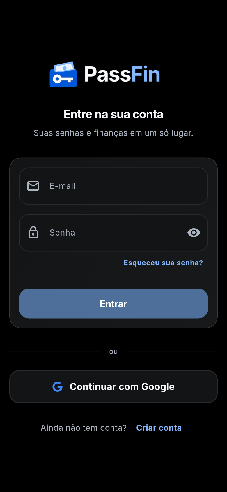</a>
  <a href="docs/branding/register-light.png">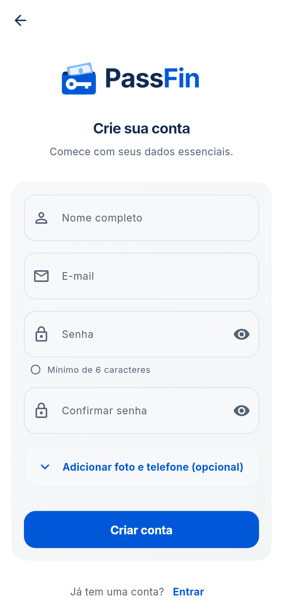</a>
  <a href="docs/branding/register-dark.png">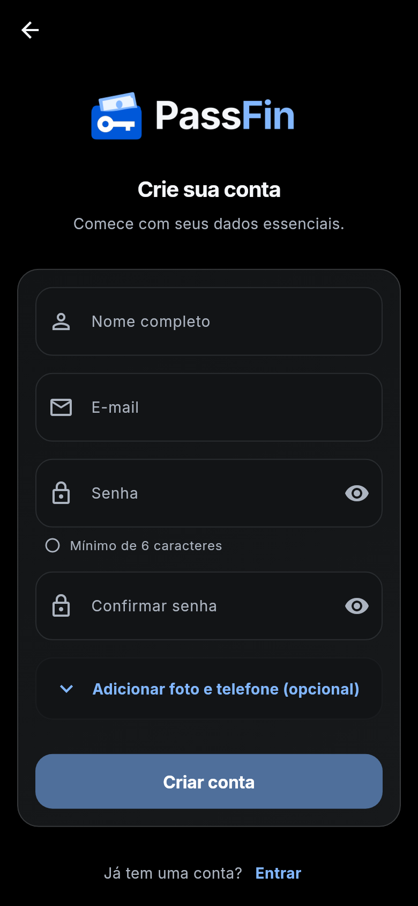</a>

### Painel e metas

  <a href="docs/images/dashboard-light-current.png">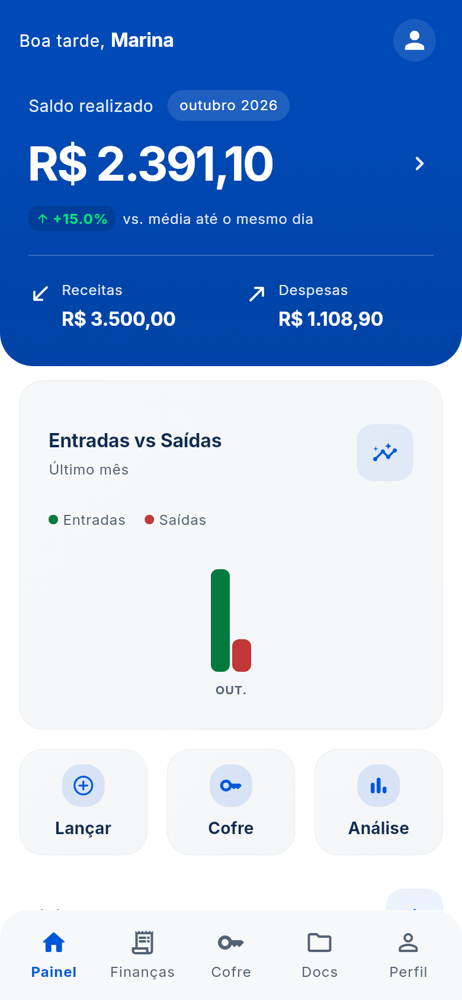</a>
  <a href="docs/images/dashboard-dark-current.png">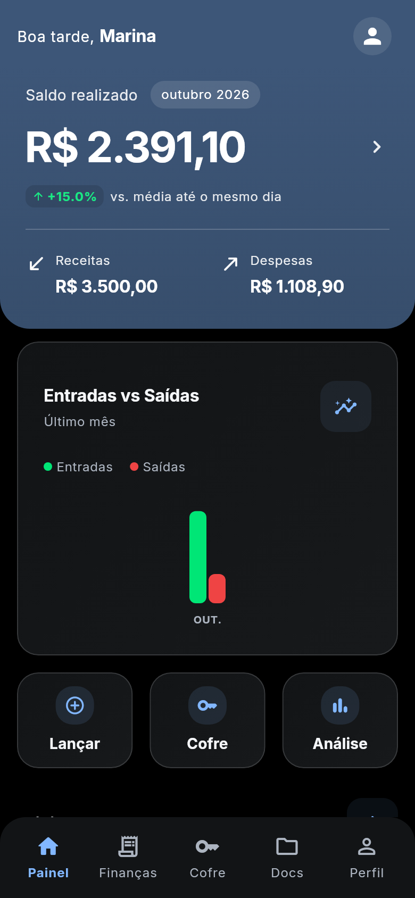</a>
  <a href="docs/images/goals-light-current.png">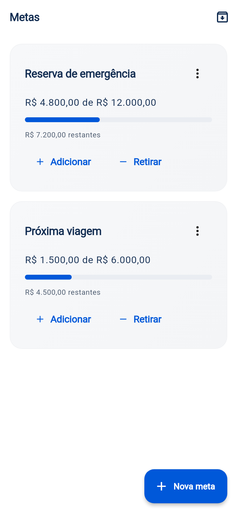</a>
  <a href="docs/images/goals-dark-current.png">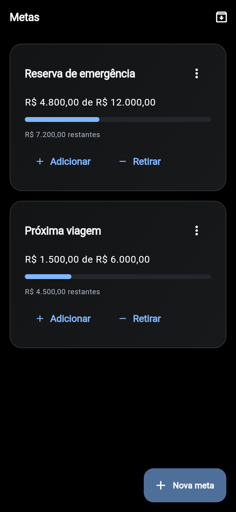</a>

### Lançamentos e análise financeira

  <a href="docs/images/expense-light-current.png">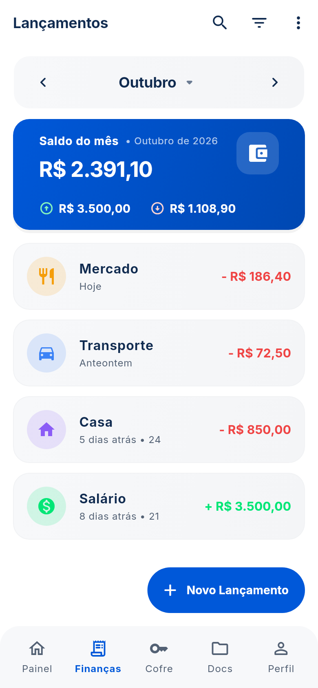</a>
  <a href="docs/images/expense-dark-current.png">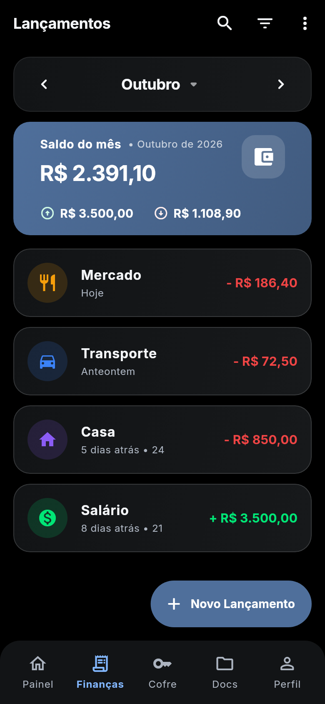</a>
  <a href="docs/images/analysis-light-current.png">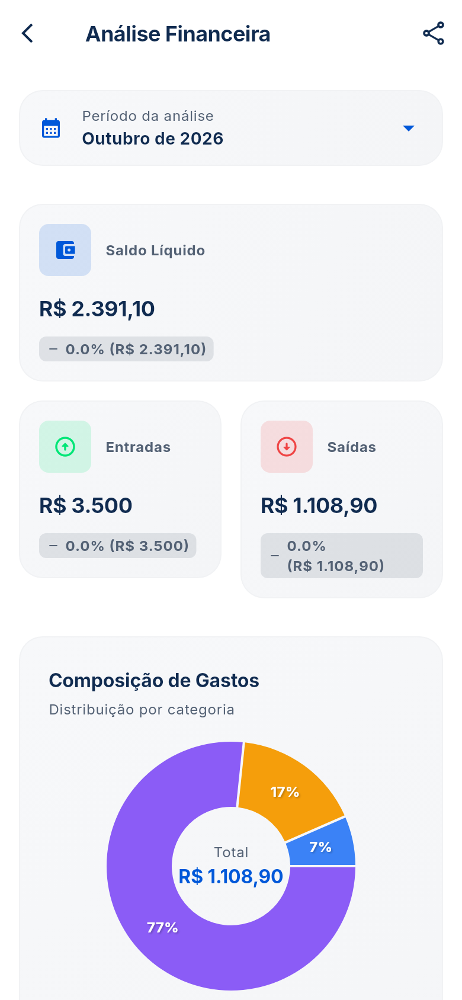</a>
  <a href="docs/images/analysis-dark-current.png">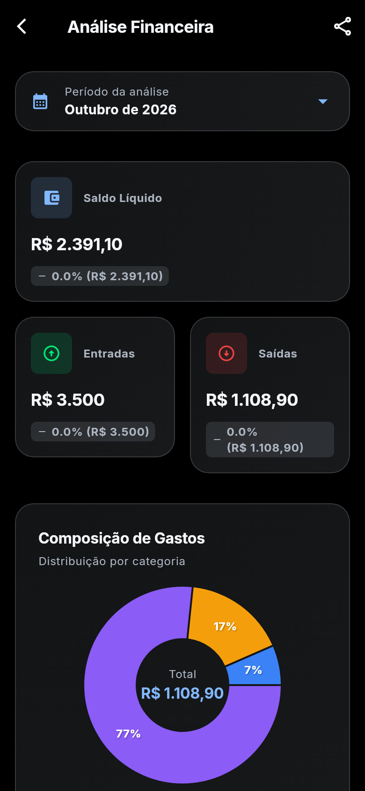</a>

### Credenciais e documentos

  <a href="docs/images/credentials-light-current.png">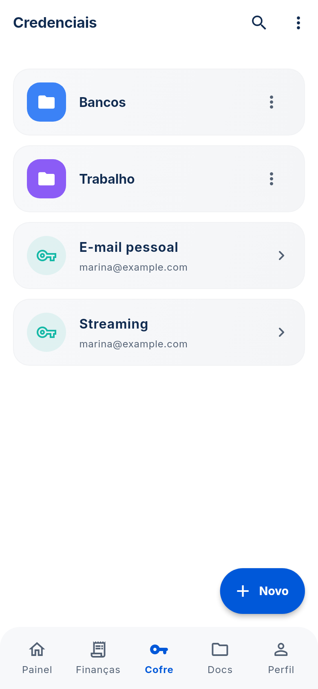</a>
  <a href="docs/images/credentials-dark-current.png">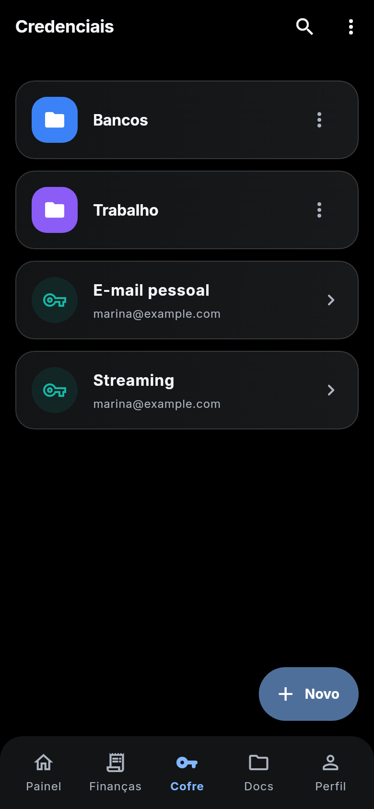</a>
  <a href="docs/images/documents-light-current.png">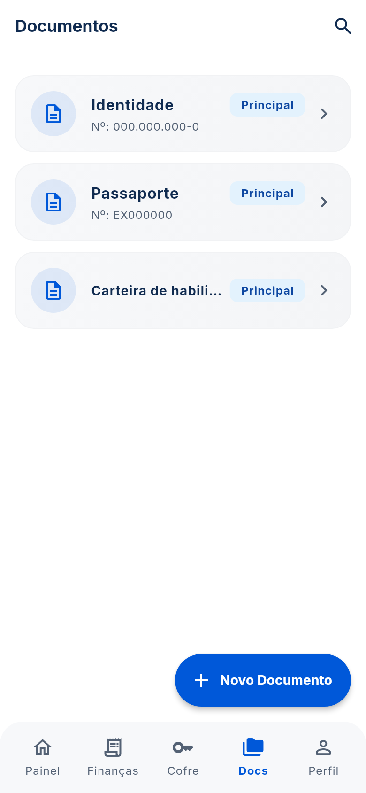</a>
  <a href="docs/images/documents-dark-current.png">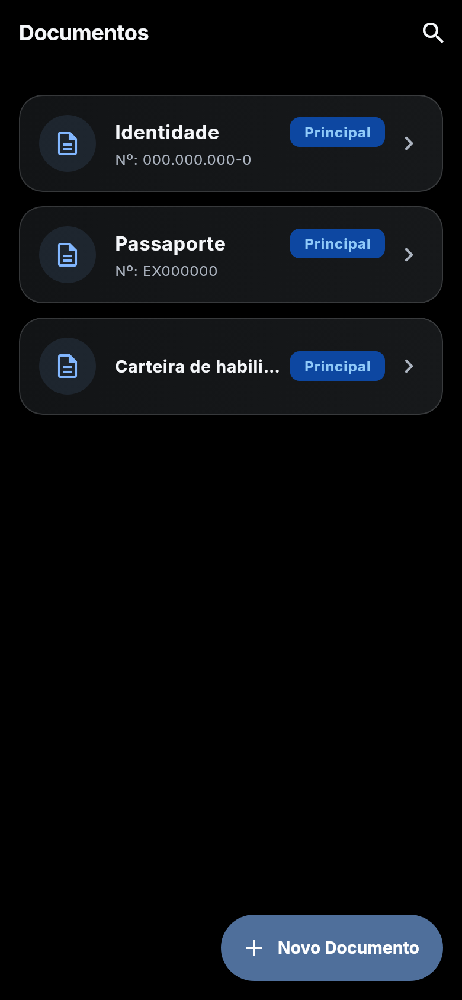</a>

## Widgets no Android

Cinco widgets Android exibem gastos, saldo e próximos pagamentos ou permitem adicionar uma despesa. As cores acompanham a aparência do aplicativo, e os valores ficam ocultos por padrão.

  <a href="docs/images/widget-selection-light-current.png">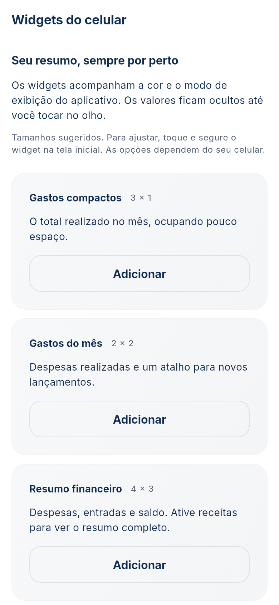</a>
  <a href="docs/images/widget-selection-dark-current.png">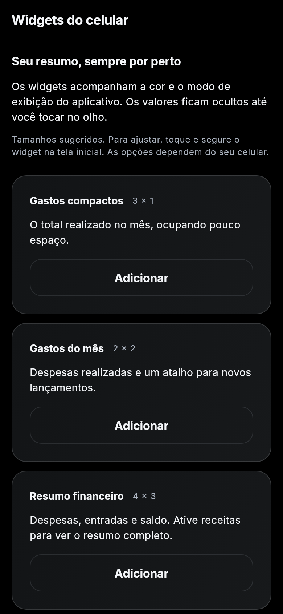</a>
  
  

As duas últimas imagens mostram os widgets na versão anterior à identidade PassFin.
