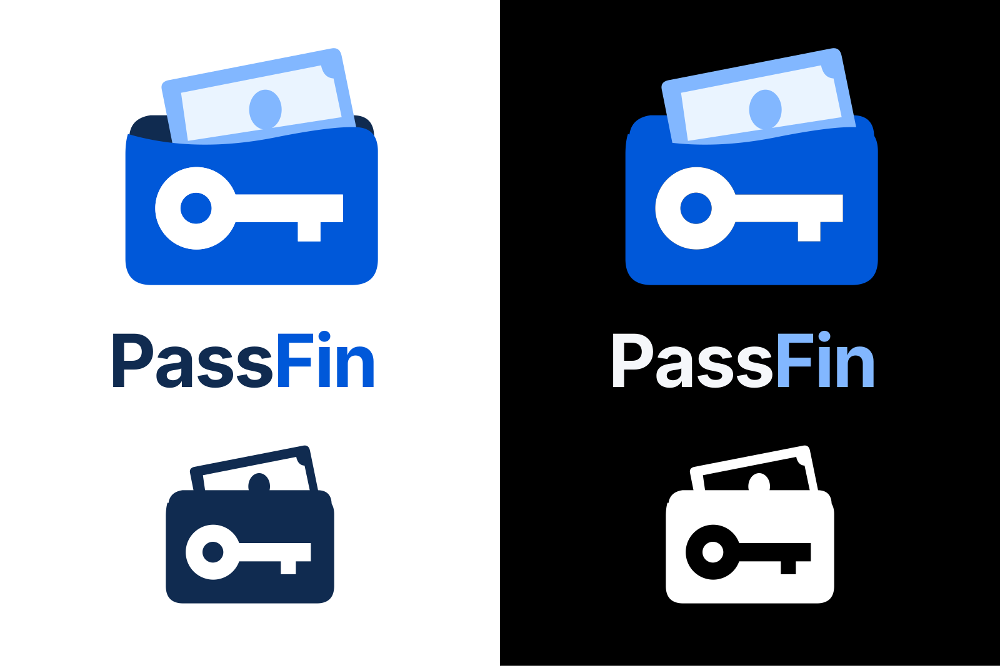

# PassFin — identidade mobile

A direção aprovada é uma carteira arredondada com **uma cédula** e uma chave central, sem fecho. Os vetores foram redesenhados como curvas e formas reais, não como imagem raster embutida. O nome nos SVGs foi convertido em contornos a partir de Inter Bold (licença OFL em assets/fonts), sem dependência de fontes instaladas.



## Arquivos

Todos os SVGs e PNGs principais estão em `assets/brand/`:

| Arquivo | Uso |
| --- | --- |
| `passfin-mark-light.svg` / `.png` | Símbolo colorido sem nome, transparente, tema claro e PDF |
| `passfin-mark-dark.svg` / `.png` | Símbolo colorido para tema escuro |
| `passfin-mark-mono.svg` / `.png` | Uma cor escura, com recortes transparentes |
| `passfin-mark-inverse.svg` / `.png` | Uma cor branca para fundos escuros |
| `passfin-lockup-light.svg`, `passfin-lockup-dark.svg` | Assinatura horizontal com nome em curvas |
| `passfin-stacked-light.svg`, `passfin-stacked-dark.svg` | Composição vertical com nome |
| `passfin-app-icon.svg` / `.png` | Ícone sem nome, fundo branco opaco, 1024 px |
| `passfin-app-icon-dark.svg` / `.png` | Alternativa sem nome, fundo preto opaco |
| `passfin-symbol-*.png`, `passfin-signature-*.png` | PNGs usados pelo Flutter, com variantes 2x e 3x |

O componente `PassFinBrand` escolhe a assinatura ou o símbolo e a variante conforme o tema. O Flutter usa PNGs produzidos a partir dos mesmos vetores, sem adicionar dependência SVG em tempo de execução. A transparência externa é preservada; a chave das versões coloridas é branca para manter a leitura em qualquer superfície.

## Aplicação

- Login, cadastro e recuperação: assinatura horizontal com nome e sem caixa decorativa.
- Inicialização Flutter: assinatura e indicador de progresso.
- Bloqueio: símbolo e título de estado.
- Perfil: assinatura discreta no rodapé.
- PDFs: símbolo na área já reservada à marca.
- Android: nome PassFin, ícones legados em cinco densidades, adaptive icon e camada monocromática para ícones temáticos no Android 13+.
- Abertura nativa: símbolo sem nome; fundo branco ou preto seguindo o modo do sistema. A preferência interna do usuário passa a valer depois que o Flutter carrega.
- Catálogo iOS preparado em `docs/branding/ios/AppIcon.appiconset`. Este repositório não tem um projeto Runner iOS configurado; o catálogo está pronto para futura integração, mas não foi aplicado ou validado em iOS.

O launcher normal permanece branco para consistência. O launcher temático usa a camada monocromática e as cores escolhidas pelo Android. Não colocar o nome dentro do ícone e não adicionar cantos arredondados ao arquivo-base: o sistema aplica a máscara. A arte adaptativa fica centralizada dentro da área segura.

## Cores e uso

- Azul da marca: `#0058D9`.
- Azul-claro da cédula e destaque escuro: `#82B7FF`.
- Nome no claro: `#102B50`; no escuro: `#F5F7FA`.
- Fundo da interface: `#FFFFFF` / `#000000`.
- Superfícies: `#F7F8FA` / `#121416`.
- Superfícies elevadas: `#EAEDF2` / `#23262B`.

Manter as proporções. Preferir símbolo a partir de 32 px; para assinatura horizontal, usar pelo menos 180 px. Não recolorir a marca com a preferência de cor do usuário. Usar as versões de uma cor para gravação, impressão limitada e ícones temáticos. Os SVGs já incluem espaço livre ao redor do símbolo.

## Reprodução

```sh
python3 -m venv /tmp/passfin-brand-venv
/tmp/passfin-brand-venv/bin/pip install -r tools/branding/requirements.txt
/tmp/passfin-brand-venv/bin/python tools/branding/generate.py
```

O gerador contém a geometria canônica e produz os vetores, PNGs, recursos Android e catálogo portátil iOS. Requer a biblioteca Cairo do sistema. Para alterar a geometria de forma consistente, editar o gerador e gerar novamente. A execução não sobrescreve as logos históricas em `assets/icon/`.

Capturas do login Flutter nos dois temas, renderizadas em teste com largura lógica de 390 px e densidade 2x:

[Login claro](login-light.png) · [Login escuro](login-dark.png)


```sh
flutter test --dart-define=CAPTURE_BRAND=true test/visual/passfin_brand_test.dart
```

O pacote Dart é `passfin`. O `applicationId` e o namespace Android continuam `com.vinicius.key_budget`, junto com os nomes dos receivers, para que PassFin seja uma atualização da instalação existente e mantenha dados privados, chaves locais e widgets. O novo esquema de links é `passfin://`, com `keybudget://` preservado como alternativa. Formatos de backup, contextos criptográficos, IDs de recorrências e pasta existente do Drive continuam compatíveis com os dados anteriores. As alterações são registradas em commits separados de identidade, interface e integração mobile.

## Validação desta implementação

- Suíte completa: 477 testes aprovados, incluindo backups, restauração, dados legados, autenticação, bloqueio, navegação, contraste e paletas dos widgets. Um teste de integração Firebase foi ignorado porque exige `VAULT_EMULATOR_TESTS`.
- Os testes visuais incluídos verificam a logo carregada, identificação acessível e fundo branco/preto no login mobile.
- Build Android debug gerado; manifesto empacotado verificado com nome PassFin, ícone adaptativo e `com.vinicius.key_budget`.
- Atualização instalada com `adb install -r` sobre o KeyBudget 0.3.0 no emulador, passando para 0.4.0 com o mesmo UID (`10217`) e a data de instalação original. Não houve desinstalação ou limpeza de dados.
- Análise estática completa de `lib` e `test` sem problemas.
- Não foi realizada instalação em um smartphone físico nesta etapa. O pacote iOS é apenas uma exportação de recursos, sem build iOS.

A atualização precisa manter também a assinatura do aplicativo instalado. Não desinstalar a versão antiga para aplicar a nova marca. A verificação em emulador confirma a continuidade da instalação; ela não substitui a conferência dos dados reais e de um backup no aparelho do usuário.

Referências: [configuração Android no Firebase](https://firebase.google.com/docs/android/setup) e [login Google no Android](https://firebase.google.com/docs/auth/android/google-signin).
